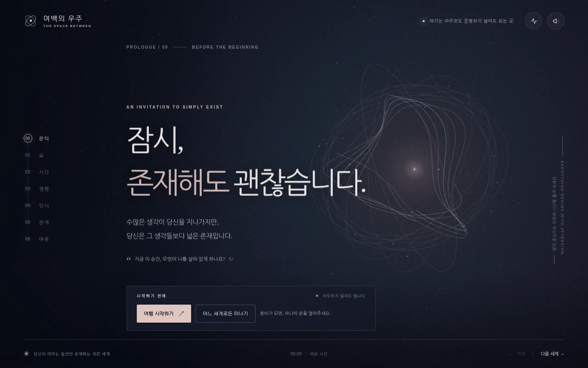

# 여백의 우주 — THE SPACE BETWEEN

> 세상이 너무 크게 느껴질 때, 우주를 조금만 안쪽으로 돌려보세요.



GitHub Pages에 올리면 작동하는, 백엔드 없는 인터랙티브 명상·예술 웹사이트입니다. 상업 광고, 서버 통신, 분석 스크립트, 사용자 계정, 외부 API 키가 없습니다.

## 들어 있는 공간

- **00 문턱** — 반응하는 빛과 움직이는 경계, 여행의 입구
- **01 숨** — 자신만의 속도로 바라보는 살아 있는 호흡의 구
- **02 시간** — 과거와 미래의 시선을 이동시키고 '지금'에 머무르기
- **03 생명** — 하늘을 탭하거나 버튼을 눌러 자라는 나만의 정원
- **04 인식** — 빛과 그림자를 뒤집고 시점을 움직여보는 감각의 렌즈
- **05 관계** — 마음속 단어를 별로 만들고 서로 연결되는 별자리
- **06 여운** — 지나온 행동을 재료로 기기에서 생성하는 짧은 편지, 메모, 텍스트 내보내기

## 배포

1. ZIP 압축을 풉니다.
2. `index.html`, `css`, `js`, `assets` 폴더를 GitHub 저장소의 루트(또는 원하는 서브폴더)에 업로드합니다.
3. 저장소 **Settings → Pages → Build and deployment**에서 **Deploy from a branch**, `main`, `/ (root)`를 선택합니다.
4. 배포된 Pages 주소로 접속합니다.

ZIP에 포함된 `index.html`을 더블클릭해 로컬에서도 실행할 수 있습니다. 별도 `npm install`, 빌드, 서버, API 키가 필요하지 않습니다.

## 입력·프라이버시

- 씨앗, 별자리 단어, 횟수, 메모는 브라우저의 `localStorage`에 **이 기기 안에서만** 저장됩니다. 사이트 운영자에게 전송되지 않습니다.
- `흔적 비우기`로 저장된 여행 정보를 초기화할 수 있습니다.
- 문장 복사/텍스트 다운로드 기능은 브라우저에서 처리합니다.
- 앰비언트 소리는 이용자가 버튼을 눌러야 시작되며 Web Audio API로 직접 생성됩니다. 외부 오디오 파일이 없습니다.
- 한글 웹폰트는 Google Fonts에서 받을 수 있습니다. 연결이 없으면 설치된 기본 서체로 대체되어 기능은 그대로 작동합니다. 완전한 네트워크 제로 배포를 원한다면 CSS의 첫 `@import` 줄을 제거하면 됩니다.

## 조작

- 왼쪽(모바일에서는 상단)의 숫자로 장소 이동
- `→` / `←` 방향키로 다음 / 이전, `0`~`6`으로 공간 직접 이동
- 숨 장면에서 `Space` 키는 한 호흡 기록
- 생명·관계 장면에서는 캔버스 영역을 클릭/탭해 직접 배치 가능
- 상단 버튼으로 소리와 모션의 크기를 조절할 수 있습니다.

**주의**: 시각적·시적 휴식 경험을 위한 공간입니다. 치료 또는 의학적 효과를 주장하거나 보장하지 않습니다.

## 파일 구성

```
index.html
css/style.css
js/app.js
assets/icon.svg
assets/preview.webp
README.md
```

모든 코드는 별도 프레임워크 없이 작성되어 있어 자유롭게 수정할 수 있습니다.
