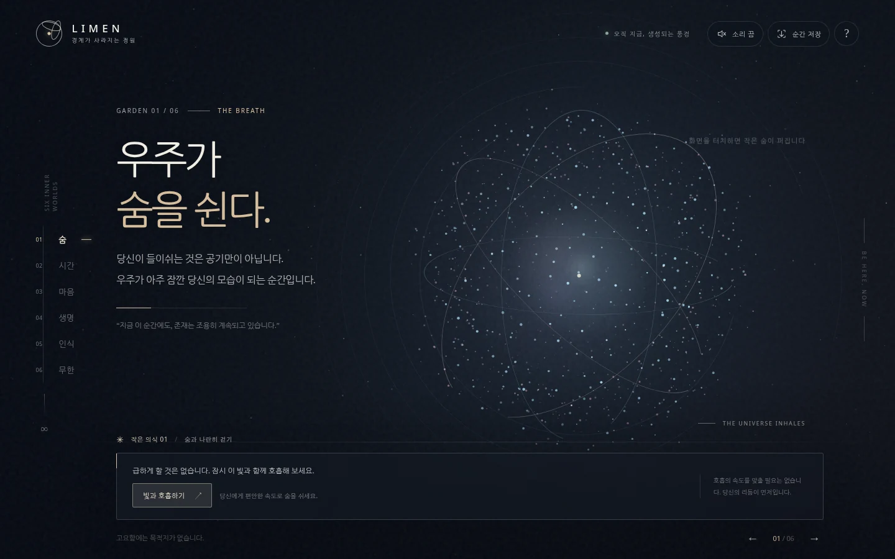

# LIMEN — 경계가 사라지는 정원

**접속하는 사람의 손길에 따라 우주가 새로 그려지는, 독립형 인터랙티브 사유 공간.**

여섯 개의 정원을 지나며 숨·시간·마음·생명·인식·무한에 대한 서로 다른 풍경을 경험합니다. 미리 그려진 이미지나 영상이 아니라, 방문할 때마다 자바스크립트가 도형과 입자를 다시 계산해 생성합니다.

## 여섯 개의 정원

| 정원 | 인터랙션 |
|---|---|
| 01 숨 | 3차원으로 회전하는 호흡하는 빛의 구체. 화면 터치로 파문 만들기, 선택적 편안한 호흡 안내 |
| 02 시간 | 시간이 나선으로 그려집니다. 슬라이더로 기억↔가능성 시점을 바꾸고 순간을 일시정지 |
| 03 마음 | 물 위에 마음을 적어 내려놓으면 글자가 서서히 떠오르며 잦아듭니다. 직접 터치하여 잔물결 만들기 |
| 04 생명 | 클릭한 곳에 매번 다른 프랙털 식물을 심습니다. 가지와 잎이 순차적으로 자랍니다 |
| 05 인식 | 3D 곡면이 원환에서 뫼비우스 띠로 서서히 변화합니다. 드래그하여 관찰자의 시점을 이동 |
| 06 무한 | 별을 터치하여 연결하면 자신만의 성좌가 만들어집니다. 별자리의 이름을 받고, 지나온 정원의 선택에서 만들어진 개인적인 편지를 읽고, 이미지로 저장 |

여섯 번째 정원에서 별을 두 개 이상 연결하고 **별자리의 이름 듣기**를 누르면, 이 방문에서 남긴 흔적을 담은 짧은 편지가 나타납니다. 편지는 복사할 수 있고 어떠한 서버에도 저장되지 않습니다.

상단에 **소리 켜기**(직접 누를 때만 재생), **순간 저장**(PNG), **도움말** 버튼이 있습니다. 키보드 좌우 화살표로 정원을 전환할 수 있습니다.

## GitHub Pages에 배포

1. ZIP을 풀어 나온 파일들(`index.html`, `style.css`, `app.js`, `favicon.svg`, `.nojekyll` 등)을 GitHub 저장소의 **루트 폴더**에 업로드합니다.
2. 저장소 **Settings → Pages → Build and deployment → Deploy from a branch**를 고릅니다.
3. **Branch: `main`, Folder: `/ (root)`**를 설정하고 저장합니다.
4. Pages에 표시되는 주소에서 접속하면 됩니다. 다른 하위 경로에서 호스팅해도 상대 경로가 유지됩니다.

**로컬 실행:** `index.html`을 더블클릭하여 열 수 있습니다. 별도의 빌드, npm, 개발 서버가 필요하지 않습니다.

## 프라이버시와 기술

- **HTML + CSS + 순수 JavaScript**, Canvas 2D 및 Web Audio API. 외부 라이브러리, 외부 글꼴, API 키, HTTP 요청이 없습니다.
- 사용자가 적은 마음의 문장은 현재 탭의 메모리 안에서만 짧게 그려집니다. 저장하거나 전송하지 않습니다.
- 오디오는 초기 상태에서 꺼져 있으며, 이용자가 명시적으로 켠 경우에만 브라우저에서 즉석 합성됩니다. 녹음·통신이 없습니다.
- 가급적 모바일 성능을 유지하기 위해 화면 크기에 맞춰 입자 수와 렌더링 프레임을 조절합니다.
- OS의 **움직임 줄이기**(`prefers-reduced-motion`) 설정을 존중합니다.
- 별자리를 포함한 모든 이미지는 브라우저에서 생성·다운로드됩니다. 사이트는 개인정보를 요구하지 않습니다.

## 수정하기

- 시와 각 세계의 설명: `app.js`의 `scenes` 객체
- 시각적 요소: `app.js`의 `drawBreath`, `drawTime`, `drawMind`, `drawLife`, `drawPerception`, `drawInfinity`
- 레이아웃과 컬러: `style.css`
- HTML 기본 마크업: `index.html`

© 2026 LIMEN. 하나의 세계보다, 수없이 많은 관점이 더 아름다울 수 있다는 생각에서 시작된 작품입니다.
