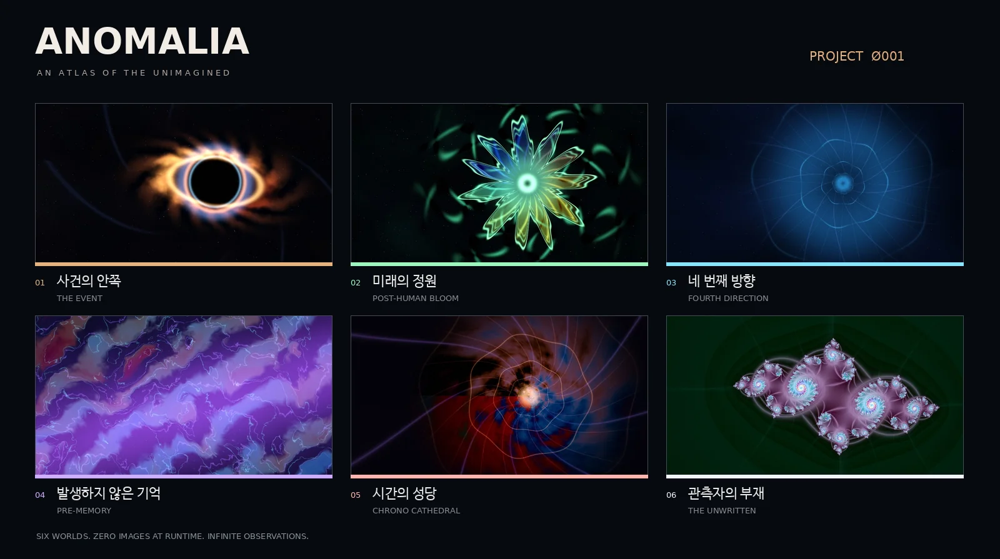

# ANOMALIA — 상상력 바깥의 지도

**AN ATLAS OF THE UNIMAGINED**



이것은 사진 갤러리도, 영상 플레이어도 아닙니다. **방문자의 커서·클릭·선택과 함께 실시간으로 생성되는 디지털 우주 전시관**입니다.

- 세계 01 — **사건의 안쪽**: 빛과 중력이 서로의 기원이 되는 사건 지평선
- 세계 02 — **미래의 정원**: 진화하지 않은 생명이 피워내는 발광 꽃
- 세계 03 — **네 번째 방향**: 실제 사차원 정육면체의 회전과 투영
- 세계 04 — **발생하지 않은 기억**: 미래의 기억으로 출렁이는 간섭의 바다
- 세계 05 — **시간의 성당**: 끝이 시작과 연결된 수학적 회랑
- 세계 Ø — **관측자의 부재**: 다섯 개의 세계를 방문해야 열리는 숨겨진 프랙탈 세계

## GitHub Pages에 배포하기

1. GitHub에서 새 **Public** 저장소를 만듭니다. 저장소 이름은 자유롭게 지정할 수 있습니다.
2. 이 ZIP을 **압축 해제**한 뒤, 안의 파일들(`index.html`, `styles.css`, `app.js`, `favicon.svg`, `preview.webp`, `README.md`, `LICENSE`)을 저장소 **최상위 경로**에 업로드하고 커밋합니다. ZIP 파일 자체를 올리는 것이 아닙니다.
3. GitHub 저장소에서 **Settings → Pages**로 이동합니다.
4. **Build and deployment → Source: Deploy from a branch**, **Branch: main**, **Folder: / (root)**를 선택하고 **Save**를 누릅니다.
5. Pages에 게시된 링크를 열면 바로 실행됩니다. 별도의 서버, npm, Node.js, 빌드 또는 API 키는 필요하지 않습니다.

로컬에서 간단히 확인하려면 `index.html`을 더블클릭해 브라우저에서 열거나, 폴더에서 `python -m http.server 8000`을 실행한 후 `http://localhost:8000`을 방문하면 됩니다.

## 사용법

| 조작 | 결과 |
| --- | --- |
| 마우스 이동 / 터치 | 관측 방향을 바꿉니다 |
| 배경 클릭 / `Space` | 세계에 파동을 만듭니다 |
| `←`, `→` / 화면 오른쪽 목록 / 좌우 스와이프 | 다른 세계를 관측합니다 |
| `1`~`5` | 해당 세계로 바로 이동합니다 |
| `R` | 새로운 세계의 상수(시드)를 생성합니다 |
| `S` | 현재 화면을 1600×900 PNG로 저장합니다 |
| `J` | 시드에 따라 생성되는 문장을 관측 일지에 저장합니다 |
| `M` | 합성된 앰비언트 사운드를 켜고 끕니다. 최초에는 꺼져 있습니다 |
| `H` | 조작 안내를 엽니다 |
| `Esc` | 안내나 일지를 닫습니다 |

브라우저 주소의 `?seed=...&world=...`가 세계의 좌표를 나타냅니다. '현재 우주 좌표 복사' 버튼으로 공유할 수 있습니다. 숨겨진 세계는 먼저 탐색하여 잠금 해제해야 합니다.

## 구성

```text
index.html      의미 있는 콘텐츠·탐색·모달 인터페이스
styles.css      반응형 시네마틱 인터페이스와 접근성 설정
app.js          WebGL2 GLSL 셰이더 6종, 4D 도형 엔진, UI, 사운드, 백업 2D
favicon.svg     작은 궤도 심볼
preview.webp    GitHub README 전시용 미리보기 (페이지 동작에는 불필요)
README.md       배포 및 조작 안내
LICENSE         MIT 라이선스
```

## 기술 및 개인정보

- **완전 정적 사이트**: 브라우저 내부 연산만 사용합니다. 외부 CDN, API 호출, 서버, 폰트 다운로드, 쿠키, 광고 및 분석 도구가 없습니다.
- **WebGL2**를 사용할 수 있으면 6종의 실시간 GLSL 셰이더가 작동합니다. WebGL2가 차단되거나 지원되지 않으면 **Canvas 2D 대체 시각화**로 전환되며, 화면 이동 및 일지 기능은 유지됩니다.
- **사차원 도형**은 정점 16개와 연결선 32개를 4D 평면에서 회전한 뒤 3D, 2D로 투영합니다. 물리학 시뮬레이션이 아닌 수학적 시각 예술입니다.
- **소리**는 Web Audio API 오실레이터로 합성합니다. 버튼을 누른 뒤에만 재생되며 외부 오디오를 다운로드하지 않습니다.
- **관측 일지**는 브라우저 `localStorage`, 잠금 해제 진행도는 `sessionStorage`에만 저장됩니다. 어디에도 전송되지 않습니다.
- `prefers-reduced-motion`을 존중하며, 키보드 탐색과 기본 대체 시각화가 포함되어 있습니다. 매우 오래된 모바일 기기에서는 렌더링이 느려질 수 있습니다.

## 소스 수정

- 세계 이름·설명·관측문: `app.js`의 `scenes`
- 셰이더 수학 및 색상: `app.js`의 `fragmentShader`
- 4D 투영 및 움직임: `app.js`의 `drawTesseract()`
- 글꼴·간격·레이아웃: `styles.css`
- 진입 화면·버튼·구조: `index.html`

**이 전시는 매 순간 새로 그려집니다.** `preview.webp`는 미리보기일 뿐, 실행 중 표시되는 그래픽은 모두 실시간 생성됩니다.
