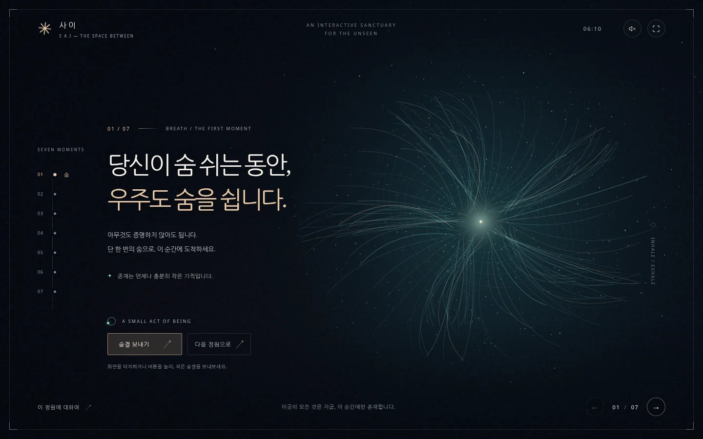

# 사이 SAI — 보이지 않는 것들의 정원

**숨 · 시간 · 생명 · 인식 · 연결 · 비움 · 귀환**

하나의 정답 대신, 일곱 개의 체험을 담은 인터랙티브 정적 사이트입니다. 각 장면의 모든 그래픽은 Canvas 2D로 실시간 생성됩니다. 방문자의 행동을 추적하거나 외부 서버로 보내지 않습니다.

## 체험하기

| 장면 | 체험 |
|---|---|
| 01 숨 | 유기적인 빛이 호흡합니다. 배경 또는 `숨결 보내기` 버튼을 누르세요. |
| 02 시간 | 시간 감각 슬라이더와 잠시 멈추기로 흐름을 바꿉니다. |
| 03 생명 | 빈 공간을 누르면 고유한 빛의 나무가 자랍니다. |
| 04 인식 | 포인터나 터치로 숨은 무늬를 발견하고 관점을 뒤집습니다. |
| 05 연결 | 별 두 개를 터치해 잇거나 뜻밖의 별을 자동 연결합니다. |
| 06 비움 | 짧은 문장을 입력하면 브라우저 안에서만 빛의 입자로 분해됩니다. |
| 07 귀환 | 방문 중의 상호작용으로 생성된 1600×1100 PNG 이미지를 내려받습니다. |

화면 좌측의 번호(모바일은 우측 상단 메뉴)를 눌러 장면을 선택하거나 `←`, `→`, `1`~`7`로 이동합니다. 오른쪽 상단의 소리 아이콘으로 선택적 Web Audio 사운드를 켤 수 있습니다. 첫 실행은 무음입니다.

## GitHub Pages 배포

1. ZIP을 해제합니다.
2. **`index.html`, `styles.css`, `app.js`, `favicon.svg`가 저장소의 공개 루트에 있도록** 업로드합니다. 폴더 하나를 통째로 저장소 루트에 넣었다면 공개 경로를 그 폴더로 설정해야 합니다.
3. GitHub 저장소 **Settings → Pages → Build and deployment**에서 **Deploy from a branch**를 선택합니다.
4. `main` 브랜치 / `/(root)`를 선택하여 저장합니다.
5. 배포 URL을 방문합니다. 사용자 정의 도메인을 사용한다면 DNS 및 GitHub Pages의 Custom domain을 별도 설정합니다.

정적 파일이므로 파일 관리자에서 `index.html`을 더블클릭해도 대부분의 기능이 실행됩니다. 별도 빌드, npm 설치, 키 설정, 백엔드가 필요 없습니다.

## 구성 파일

```
index.html       접근성 및 메타데이터를 포함한 7개 장면의 인터페이스
styles.css       PC/모바일 반응형 디자인, 모션 감소 옵션
app.js           7개 Canvas 장면, 입력 처리, Web Audio, PNG 내보내기
favicon.svg      자체 제작 로고
README.md        사용 및 배포 안내
```

## 보안 · 사생활 · 접근성

- 별도 API 키, 쿠키, 사용자 계정, 외부 라이브러리, 외부 폰트 요청, 분석 스크립트 없음.
- 비움에서 입력한 문장은 DOM과 로컬 캔버스에서만 잠시 사용하며, 전송·저장하지 않습니다.
- 마이크와 카메라를 사용하지 않습니다. 호흡은 사용자의 생체 신호를 측정하는 것이 아니라 시각적 은유입니다.
- 조작은 터치/마우스/키보드를 지원합니다. OS의 `prefers-reduced-motion` 선호도 반영.
- 오디오를 켠 경우에도 소리는 브라우저에서 합성하며 외부 오디오 파일을 읽지 않습니다.
- 파일 다운로드는 Canvas PNG를 브라우저에서 생성하며 네트워크 통신이 필요 없습니다.

## 창작 의도

이 작품은 명상을 처방하거나 심리 상태를 분석하지 않습니다. 일상에서 잠깐 빠져나와 삶과 존재의 다른 비유를 체험하게 하는 예술적 공간입니다. 고요함이 필요할 때, 아무것도 누르지 않아도 됩니다.

**SAI © 2026 — original generative web artwork**

## 미리보기



*이미지는 한 순간의 모습입니다. 실제 정원은 계속 움직이며 방문자의 터치에 반응합니다.*
